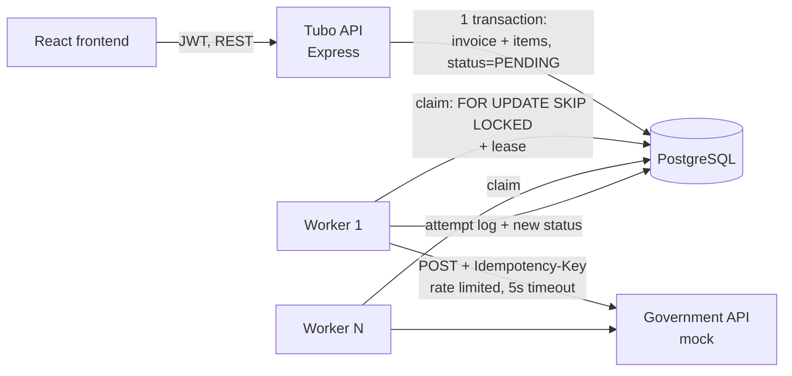

# TUBO InvoiceFlow

Businesses submit invoices to Tubo. Tubo validates and stores them, then submits them asynchronously
to an external government invoicing API, so that invoices are **never lost and never duplicated**,
even when the government API is slow, down, rejects requests, or Tubo itself crashes mid-submission.

| Part | Where |
|---|---|
| Setup, architecture, assumptions, production improvements | this file |
| Answers to the written questions (C, E, H, I, J, K, L, M, N, Q) | [docs/ANSWERS.md](docs/ANSWERS.md) |
| API reference with examples | [docs/API.md](docs/API.md) |
| Database schema (migration) | [backend/src/db/migrations/001_initial_schema.sql](backend/src/db/migrations/001_initial_schema.sql) |

---

## 1. Setup

**Requirements:** Node.js 22+, Docker (for PostgreSQL).

### Database
```bash
docker compose up -d            # PostgreSQL 16 on localhost:5433
```

### Backend (API + worker + mock government API)
```bash
cd backend
cp .env.example .env            # local dev values; never commit .env
npm install
npm run migrate                 # create tables
npm run seed                    # 2 companies, 2 users, 1 sample invoice
npm run dev                     # starts API :4000, worker, mock government API :4001
```
The three processes can also be started separately: `npm run start:api`, `start:worker`, `start:gov`.

### Frontend
```bash
cd frontend
npm install
npm run dev                     # http://localhost:5173  (proxies /api to :4000)
```

**Demo logins** (password `Password123!`):
- `usera@abc.test`: User A, **ABC Corporation**
- `userb@beta.test`: User B, **Beta Trading Ltd**

### Tests
```bash
cd backend
npm test        # unit tests + DB integration tests (database must be running and migrated)
```
Includes a test that fires **10 identical create requests at the same time** and asserts exactly one
invoice is created (Part J), and a test that User A cannot read or retry Company B's invoice (Part E1).

### Demo scenarios
| Scenario | How |
|---|---|
| Random failures | Mock returns 503 / 400 / timeout randomly (rates in `.env`) |
| Government rejects the invoice | Customer name containing `[reject]` → status `REJECTED` |
| **Part I: accepted but Tubo never got the answer** | Customer name containing `[timeout]`: the government registers the invoice but answers too late. Attempt 1 = `TIMEOUT`; attempt 2 reuses the idempotency key and gets the **same** government reference back. No duplicate. |
| **Part I: Tubo crashes after submission** | Run the worker with `CHAOS_CRASH_AFTER_SUBMIT_RATE=1 WORKER_LEASE_SECONDS=5 npm run start:worker`. It exits right after a successful submission. Start a normal worker: once the lease expires it reclaims the invoice, marks the old attempt `ABANDONED`, resends with the same key and receives the original reference. |
| Long outage → FAILED → manual retry | `curl -X POST localhost:4001/government-api/_admin/outage -H "content-type: application/json" -d '{"enabled":true}'`, create an invoice, wait for `FAILED`, disable the outage, click **Retry** |

---

## 2. Architecture



### Application structure
```
backend/src/
  server.js / worker.js       entry points: HTTP API and background worker (separate processes)
  app.js                      Express app: security middleware, versioned routes, error handling
  config.js                   all configuration from environment variables
  routes/                     HTTP layer only: parse, call service, send response
  services/                   business logic + SQL (invoice.service.js, auth.service.js)
  validation/                 zod schemas (request shape, types, limits)
  middleware/                 auth (JWT), validation, request id/logging, error handler
  processing/                 worker logic: claim, submit, retry policy, rate limiter, government client
  lib/                        money maths (integer cents), typed errors, JSON logger
  db/                         pool, transaction helper, migration runner, SQL migrations, seed
  mock-gov/                   mock government API (separate process, behaves like a remote service)
frontend/src/
  pages/                      Login, Invoice list (dashboard), Create invoice, Invoice detail
  components/, api.js, auth.jsx
```

### Database design
- `companies` (tenants) 1–N `users`, 1–N `invoices` 1–N `invoice_items`, and `invoices` 1–N `invoice_processing_attempts`.
- UUID primary keys (not guessable/enumerable), `NUMERIC` for money, `TIMESTAMPTZ` for times, `DATE` for invoice date.
- **`UNIQUE (company_id, invoice_number)`** is the duplicate guard. `CHECK` constraints enforce valid statuses, non-negative amounts and `total = subtotal + tax`.
- The invoice row is also the job: queue fields `next_attempt_at`, `locked_by`, `locked_until`, `attempt_count`. Saving the invoice and enqueuing it happen in **one transaction**, so neither can happen without the other.
- `invoice_processing_attempts` is an append-only log: one row per attempt with start, end, duration, outcome, HTTP status, error and response body.

Details and reasoning: [docs/ANSWERS.md, Part C](docs/ANSWERS.md#part-c--database-design).

### Invoice processing flow
```
POST /api/v1/invoices
  auth → validate → compute totals → INSERT ... ON CONFLICT DO NOTHING (+ items) in one transaction
  → 202 Accepted, status PENDING             (not yet sent to the government)

Worker loop (any number of workers):
  claim due invoices  (PENDING/RETRYING whose next_attempt_at has passed, or PROCESSING with an expired lease)
     UPDATE ... status=PROCESSING, lease=60s ... FOR UPDATE SKIP LOCKED
  for each: insert attempt row → rate limiter → POST to government with Idempotency-Key = invoice.id
     200          → SUBMITTED (store government reference)
     400/422      → REJECTED  (permanent, no automatic retry)
     503/429/5xx, timeout, network error → RETRYING with exponential backoff + jitter
                    ... after MAX_AUTO_ATTEMPTS → FAILED (manual retry available)
     401/403/...  → FAILED (configuration problem)
  save attempt result + invoice status in one transaction (only if we still hold the lease)
```

| Status | Meaning |
|---|---|
| `PENDING` | Accepted and stored, waiting for a worker |
| `PROCESSING` | A worker holds the lease and is submitting |
| `RETRYING` | Temporary failure; an automatic retry is scheduled (`next_attempt_at`) |
| `SUBMITTED` | Government accepted it (final) |
| `FAILED` | Automatic retries exhausted or non-retryable error; **manual retry allowed** |
| `REJECTED` | Government says the data is invalid (final; needs a corrected invoice) |

### Authentication approach
- `POST /api/v1/auth/login` checks a bcrypt password hash and returns a JWT (HS256, 1h expiry, issuer/audience checked), signed with `JWT_SECRET` from the environment.
- The token carries `sub` (user id) and `companyId`. **Every** invoice query has `WHERE company_id = <companyId from token>`. The company is never taken from the URL or body, and unknown fields are rejected, so changing an id in the URL gets a 404 (see [E1](docs/ANSWERS.md#e1)).
- Login is rate-limited and takes the same time whether or not the email exists (no account enumeration).

---

## 3. Assumptions
- Invoice numbers are unique **per company** (two companies may both have `INV-10001`).
- The seller is always the authenticated user's company; it cannot be set in the request.
- The server calculates totals. Client totals are optional, and a mismatch returns `422 TOTALS_MISMATCH`.
- Tax is a percentage per line, rounded half-up per line to 2 decimals and then summed.
- Duplicate invoice number → `409 DUPLICATE_INVOICE` with the existing invoice id (the client can fetch it).
- The government API supports an `Idempotency-Key` (or an equivalent natural key such as seller tax id + invoice number). Everything in Part I relies on this, and real e-invoicing APIs normally provide one.
- `REJECTED` invoices are not retryable: resending identical data gives the same answer. Correcting an invoice (credit note / new version) is out of scope.
- Invoices are never deleted (legal retention), so foreign keys use `RESTRICT`.
- One user belongs to one company; roles/permissions within a company are out of scope.

## 4. Production improvements
**Reliability / scale**
- Move dispatching to a real queue (SQS/RabbitMQ) once Postgres polling becomes a bottleneck, keeping the DB as the source of truth (outbox → relay → queue).
- A **global** rate limiter for the government API shared by all workers (Redis token bucket); today each worker is limited separately.
- Circuit breaker: on a burst of 503s, pause all submissions briefly instead of each invoice backing off on its own.
- A reconciliation job that asks the government API "do you have key X?" for invoices whose outcome is unknown, and a daily report comparing Tubo with the government.
- Dead-letter dashboard and alerts for `FAILED` invoices.
- Persist the government receipt / signed XML in object storage (S3).

**Security**
- Store the JWT in an httpOnly, Secure, SameSite cookie with refresh-token rotation and revocation, instead of sessionStorage.
- Secrets in a secret manager (AWS Secrets Manager / Vault), rotated.
- API keys / OAuth client credentials for machine-to-machine invoice submission (businesses usually integrate from their ERP, not the UI).
- Postgres Row-Level Security as a second layer of tenant isolation.
- Roles and permissions, audit log of user actions, MFA.
- Dependency and container scanning in CI, WAF in front of the API.

**Operations**
- Metrics (Prometheus/OpenTelemetry): queue depth, age of oldest pending invoice, attempts/sec by outcome, government latency p95, worker utilization. Alerts on these.
- Distributed tracing with the request id propagated to the worker.
- Partition `invoice_processing_attempts` by month; archive old data.
- CI/CD with tests, containers, rolling deploys, migrations that stay backward compatible (expand → migrate → contract).
- OpenAPI spec generated from the zod schemas; client SDKs.
- Frontend: e2e tests (Playwright), form library, server-driven list refresh (SSE/WebSocket) instead of polling.
